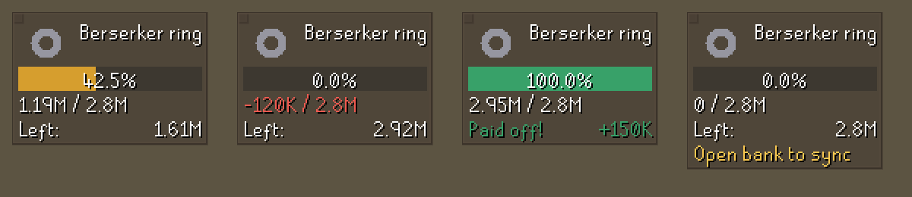

# Debt Tracker

A RuneLite plugin for Old School RuneScape. Tell it what you are in debt for, such as a
Berserker ring at 2.8m, and an overlay bar fills up as the profit you make during play pays it off.



*Preview rendered with sample values, outside the game.*

## Using it

1. Open the plugin's settings (the wrench icon in the RuneLite sidebar, then Debt Tracker).
2. Set **Debt item**, for example `Berserker ring`.
3. Set **Debt amount**, for example `2.8m`, `500k` or `2,800,000`. Leave it blank to use the item's
   current Grand Exchange price.
4. Open your bank once so the plugin knows what you already own.

Tick **Start over** to reset progress. Changing the debt item also starts from zero. Editing only the
amount keeps your progress.

## How profit is worked out

The plugin records how many of each item you own when the debt starts, across your inventory,
equipment, bank, looting bag and Grand Exchange offers. Profit is the change in those quantities,
valued at current prices.

| What you do | Effect on the bar |
| --- | --- |
| Pick up loot, or earn coins | Goes up by the item's value |
| Eat food, use supplies, lose items on death | Goes down by the item's value |
| Bank, withdraw, equip | No change |
| List on the GE, or sell an item at market price | No change, apart from the 2% tax once you collect |
| A price changes on something you have owned since the start | No change |

Unsold loot counts at its market price, so the bar can fill before you have the coins in hand.
Progress is saved per account.

## Known limitations

- **Partial GE collections overcount.** Collecting from an offer that is still filling counts those
  items or coins twice until the offer finishes and its slot is cleared, because the game does not
  report what was already collected.
- **Other storage reads as a loss.** Items moved somewhere the plugin cannot see, such as a rune
  pouch, herb sack, POH storage, or raid storage, count as lost until they come back.
- **Deposit boxes** read as a loss until your next normal bank visit, which corrects it. This only
  sticks if you use one before the plugin has ever seen your bank.
- **Check your looting bag once** before filling it, for the same reason.
- **Untradeable items** have no price, so they count as zero.

## Development

Requires JDK 11.

```bash
./gradlew test
```

```bash
./gradlew run
```

`run` opens a developer client with the plugin loaded. To log in with a Jagex account, follow
[Using Jagex Accounts](https://github.com/runelite/runelite/wiki/Using-Jagex-Accounts).

The profit logic is in `WealthLedger`, which has no game dependencies and is covered by unit tests.
See [RESOURCES.md](RESOURCES.md) for reference material.

## License

BSD 2-Clause. See [LICENSE](LICENSE).
